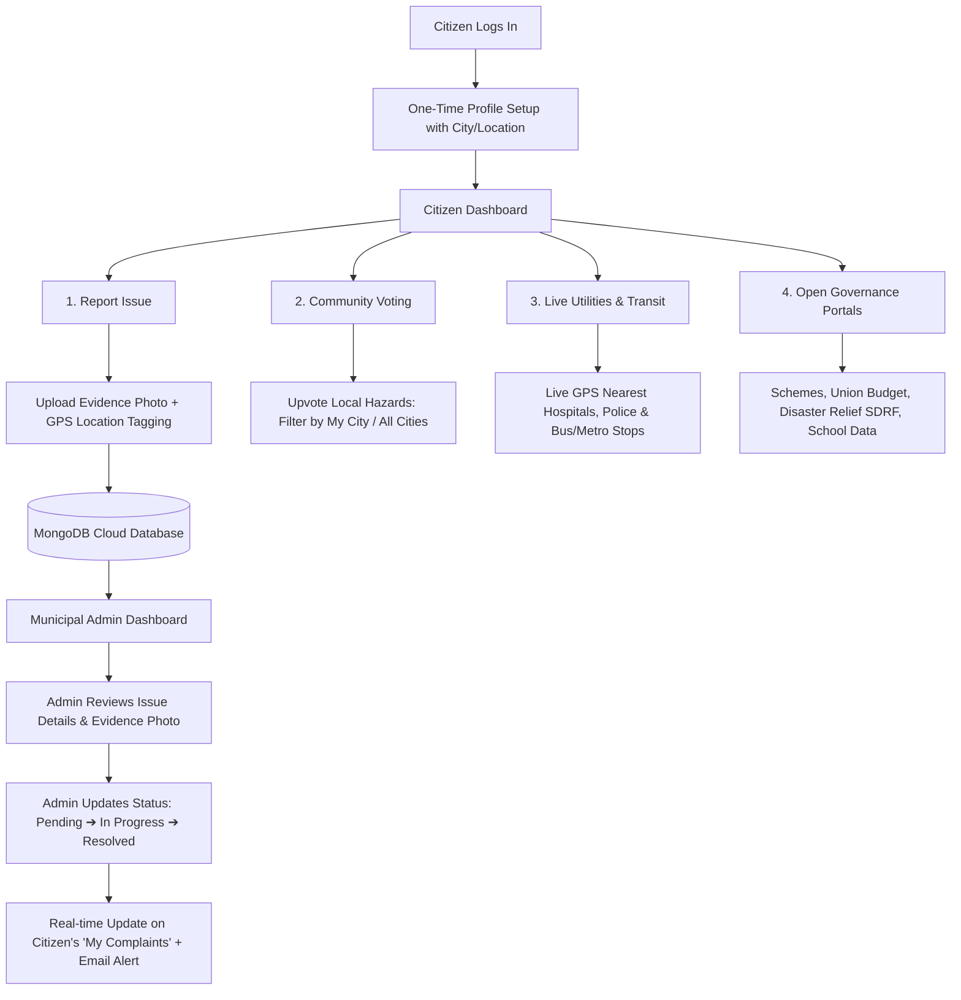

# 🏛️ Civix – Comprehensive Project Review & Viva Presentation Guide

**Project Title**: Civix (One-Stop Digital Civic Governance & Citizen Empowerment Platform)  
**Domain**: Public Governance, Citizen Grievance Redressal & Smart Cities  
**Inspiration / Theme**: Smart India Hackathon (SIH) – Citizen Welfare & Municipal Digital Transformation  

---

## 1. 🎤 30-Second Elevator Pitch (Opening Statement)

> *"Respected Evaluators, **Civix** is a full-stack digital civic engagement and governance portal designed to eliminate the friction between citizens and municipal authorities.*  
> *It transforms civic problem reporting from an opaque, slow process into a transparent, community-prioritized, and real-time tracked digital ecosystem. Alongside grievance redressal, it integrates authentic open government datasets—from national budgets and welfare schemes to live GPS-based emergency infrastructure and nationwide transit schedules."*

---

## 2. 🚨 Problem Statement vs. Civix Solution

| # | Traditional Civic Problems | How Civix Solves It |
|---|---|---|
| **1** | **No Accountability**: Grievances filed in traditional complaint boxes or paper forms get lost with zero transparency. | **Live Lifecycle Tracking**: Issues move transparently across verifiable stages (*Pending → In Progress → Resolved → Rejected*) with timestamps, officer notes, and photo audit trails. |
| **2** | **Fragmented Public Portals**: Citizens must visit 10+ different websites for transit, government budgets, welfare schemes, vehicle RTO, and disaster relief. | **One-Stop Unified Dashboard**: Brings together citizen grievance redressal, emergency services, transit locators, and authenticated public data in a unified interface. |
| **3** | **Blind Budget & Repair Prioritization**: Municipal corporations lack data on which potholes or broken lights affect the most residents. | **Democratic Community Voting**: Citizens upvote neighborhood issues with city/area filters (*My Area vs. All Areas*), allowing municipal corporators to allocate emergency budgets based on community demand. |
| **4** | **Lack of Verified Civic Information**: Citizens struggle to find official welfare criteria, disaster allocations, or voter guidelines. | **Authenticated Open Data**: Sourced directly from verified government portals (`data.gov.in`, `sansad.in`, `eci.gov.in`, `udiseplus.gov.in`, `parivahan.gov.in`) with purpose guides. |

---

## 3. 🛠️ Tech Stack (In Simple & Clear Words)

### 💻 Frontend (Client Side)
- **React.js**: Modular component architecture with custom hooks (`useAuthContext`, `useProfileStatus`).
- **Tailwind CSS**: Modern styling with responsive grid layouts and sleek Dark/Light mode theme switching.
- **Framer Motion**: Smooth page transitions, progress bars, and interactive micro-animations.
- **Lucide Icons**: Semantic iconography for accessibility and visual clarity.
- **Recharts**: Data visualization for municipal power/water utility consumption and budget allocations.

### ⚙️ Backend (Server Side)
- **Node.js + Express.js**: High-performance RESTful API server handling authentication, validation, and database operations.
- **Multer + Cloudinary API**: Secure multipart image handling and cloud hosting for complaint evidence photos.
- **JWT (JSON Web Tokens)**: Role-based authorization distinguishing between **Citizens** and **Municipal Admins**.
- **CSRF & Security Middleware**: Input sanitization via XSS filters, rate limiting, and CORS security.

### 🗄️ Database & Open APIs
- **MongoDB + Mongoose**: Document database storing user profiles, civic complaints, voting counts, and notifications.
- **OpenStreetMap (OSM) Overpass API**: Real-time geospatial queries for live GPS emergency service and transit stop lookups.
- **Official Open Datasets**: Integrated public records from `data.gov.in`, `sansad.in`, `udiseplus.gov.in`, `eci.gov.in`, and `parivahan.gov.in`.

---

## 4. 🔄 End-to-End System Architecture & Workflow

---

## 5. 📱 Step-by-Step Feature Walkthrough (Demo Script)

### 👤 Part A: Citizen Flow
1. **Authentication & Profile Setup**:
   - The user logs in and completes their verified profile (name, phone, email, and city e.g. *Vadodara / Anand / Delhi*).
2. **Filing a Civic Grievance (`/report-issue`)**:
   - The citizen describes the problem, uploads a photo of the hazard, and clicks **"Get Current GPS Location"** for automated coordinate tagging.
   - Upon submission, MongoDB stores the issue, generates a unique ticket ID, and dispatches a confirmation email.
3. **Tracking Complaints (`/complaints`)**:
   - In **My Complaints**, citizens monitor live status (*Pending → In Progress → Resolved*), date stamps, and officer remarks.
4. **Community Civic Voting (`/community-voting`)**:
   - Citizens toggle between **"📍 In My City / Area"** (auto-filtered to their profile city) and **"🌐 All Cities & Areas"**.
   - Upvoting escalates critical hazards (e.g. hazardous potholes, dark roads) on the municipal priority board.
5. **Emergency & Nearby Infrastructure Locator (`/nearby-services` & `/transport`)**:
   - Uses live device GPS and OpenStreetMap to find all hospitals, police stations, fire stations, and transit stops within 5–10km with instant Google Maps navigation.
6. **Government Knowledge & Schemes (`/govt-schemes`, `/budget`, `/sdrf`)**:
   - Citizens explore welfare allocations, Union Budget estimates vs. actual expenditures, and SDRF disaster relief with authentic citations.

---

### 🧑‍💼 Part B: Municipal Admin Flow
1. **Admin Control Center (`/admin/dashboard`)**:
   - Municipal officers access incoming citizen grievances across all wards in real-time via `issuesAPI.getAll()`.
2. **Status Progression & Audit**:
   - Officers review uploaded evidence photos and location coordinates.
   - Changing the status dropdown (*Pending → In Progress → Resolved*) triggers an instant database update and reflects on the citizen's screen.
3. **Citizen Directory & Analytics (`/admin/users` & `/admin/analytics`)**:
   - Manage registered citizen accounts, view activity metrics, and assess ward-wise resolution rates.

---

## 6. 📊 Official Data Provenance Table

| Feature / Section | Route | Authenticated Official Source | Geographic Scope | Link |
|---|---|---|---|---|
| **Public Transit** | `/transport` | OpenStreetMap Overpass (Live GPS) + Delhi DTC GTFS | Dynamic GPS Nearby (Nationwide) + Delhi GTFS | [openstreetmap.org](https://www.openstreetmap.org) |
| **Train Schedules** | `/train` | Ministry of Railways / Indian Railways | All India Network (All States & Stations) | [data.gov.in](https://data.gov.in) |
| **Govt Schemes** | `/govt-schemes` | Ministry of Social Justice & Empowerment | All 28 States & 8 Union Territories | [data.gov.in](https://data.gov.in) |
| **Union Budget** | `/budget` | Rajya Sabha / Ministry of Finance | Union & State Allocations | [sansad.in](https://sansad.in) |
| **Disaster Relief & NFSA** | `/sdrf` | Ministry of Home Affairs & Consumer Affairs | State & District-wise Quotas | [data.gov.in](https://data.gov.in) |
| **Civic Statistics** | `/civic-stats` | Census of India & Ministry of Jal Shakti | National, State & District Indicators | [censusindia.gov.in](https://censusindia.gov.in) |
| **School Data** | `/school` | UDISE+ / Ministry of Education | State, District & Block Level | [udiseplus.gov.in](https://udiseplus.gov.in) |
| **Election Portal** | `/elections-info` | Election Commission of India (ECI) | National & Constituency Level | [eci.gov.in](https://eci.gov.in) |
| **Vehicle Services** | `/vehical` | MoRTH Parivahan Seva / Vahan / Sarathi | All State & UT RTOs | [parivahan.gov.in](https://parivahan.gov.in) |
| **Emergency Services** | `/nearby-services`| OpenStreetMap Live Overpass Geocoder | Live 10km GPS Radius | [openstreetmap.org](https://www.openstreetmap.org) |

---

## 7. ❓ Frequently Asked Questions (Viva / Review Q&A)

### Q1: Is the transport and train data restricted to Delhi only?
> **Answer**: *"No. The Train portal covers all Indian Railways stations and trains across the country from `data.gov.in`. For public transit, we developed a dual engine: a real-time OpenStreetMap GPS stop locator that discovers nearby bus and metro stops around the user anywhere in India, alongside Delhi's open GTFS directory."*

### Q2: How does data synchronization work between Citizen and Admin?
> **Answer**: *"When a citizen submits a complaint via `ReportIssue.jsx`, the payload (with Cloudinary image URL and GPS coordinates) is saved in MongoDB. The Admin Dashboard queries `issuesAPI.getAll()`. When an admin updates the status to 'In Progress' or 'Resolved', it updates MongoDB and reflects immediately on the user's `MyComplaints.jsx` screen with email notification alerts."*

### Q3: What makes Civix innovative compared to existing government portals?
> **Answer**:  
> 1. **Unified Experience**: Combines grievance redressal, emergency locator, transit, and open government data in a single responsive app.  
> 2. **Community Prioritization**: Democratic upvoting prevents critical hazards from being buried under administrative backlogs.  
> 3. **Transparency**: Every section features a verified source citation and user guide banner.  
> 4. **Live Geospatial Intelligence**: Dynamic GPS radius discovery for emergency hospitals, police stations, and transit stops.
